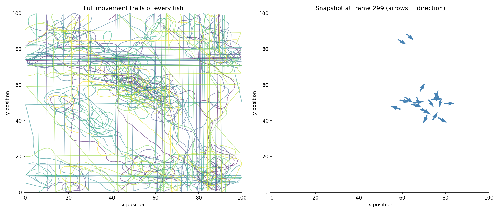
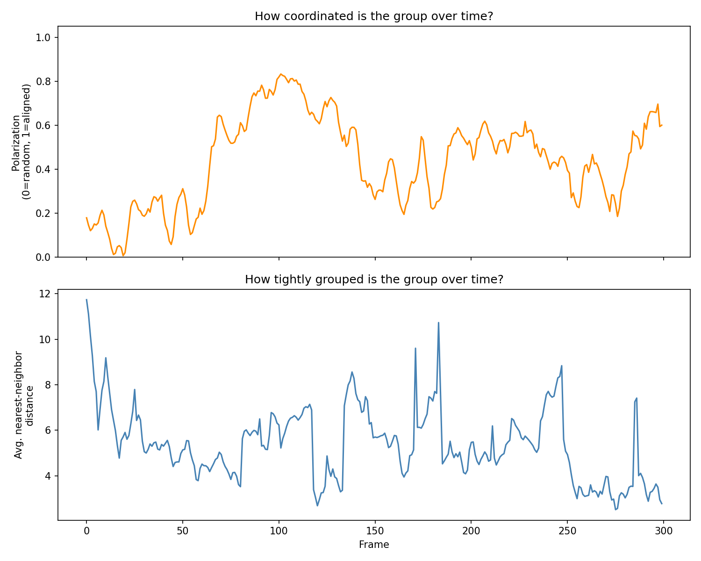
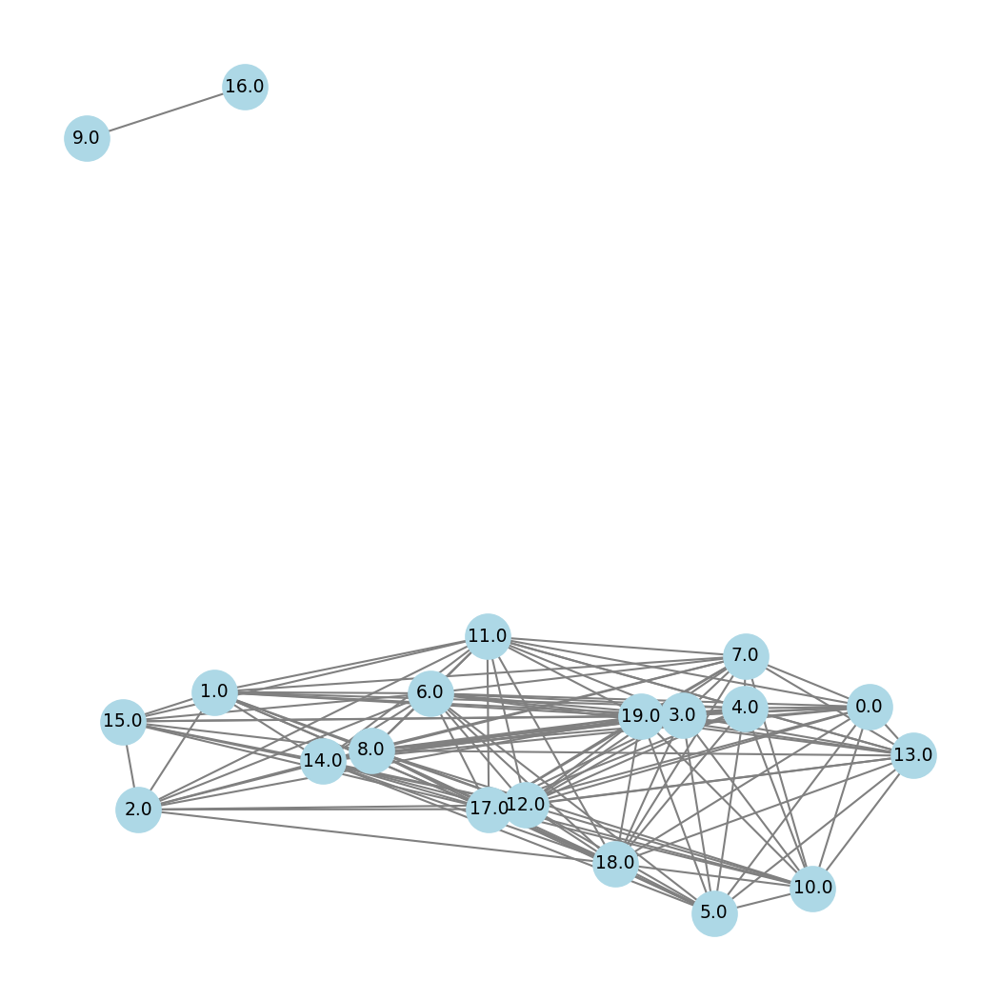

# Collective Behaviour Analysis

A Python pipeline for studying **collective behaviour**: how groups of animals (or people) move in a coordinated way without any leader. It has two parts:

1. **Simulation + analysis.** A Boids-style model of a fish school, then quantitative metrics (polarization, cohesion) and an interaction network.
2. **Live / video tracking.** A YOLOv8 tracker that follows real individuals in webcam or video footage and computes the same metrics on the fly.



## The idea

Each simulated fish follows only three local rules, applied to neighbours within a fixed radius:

| Rule | What the fish does |
|---|---|
| **Separation** | steers away from neighbours that are too close |
| **Alignment** | steers toward the average heading of its neighbours |
| **Cohesion** | steers toward the average position of its neighbours |

No fish is in charge, yet the group self-organises into coordinated motion. This is the *Boids* model (Reynolds, 1987) and a standard starting point for studying schooling and flocking.

## Metrics

| Metric | Definition | Interpretation |
|---|---|---|
| **Polarization** | ‖mean of unit heading vectors‖ | 0 = random headings, 1 = everyone aligned |
| **Cohesion** | mean nearest-neighbour distance | smaller = tighter group |
| **Interaction network** | edge between two individuals closer than a threshold | density, degree, connected sub-groups |

## Results (default settings: 20 fish, 300 frames)

- Polarization rises from **0.18** at the start (random headings) to **0.60** by the final frame (mean 0.44). Order emerges from purely local rules.
- Mean nearest-neighbour distance: **5.4 units**, in a 100 × 100 world.
- Final-frame network: 20 nodes, 131 edges, density 0.69, split into **2 sub-groups**.




## Live / video tracker (`tracker_final.py`)

- Detects and tracks a chosen class (person, bird, dog, horse, sheep, cow, …) with **YOLOv8 + ByteTrack** IDs, from a webcam or a video file.
- Overlays motion trails, interaction edges, and a short-term **predicted position** (linear extrapolation) for each individual.
- Computes polarization and cohesion live, then saves `trajectories.csv`, `metrics_over_time.csv`, `metrics_plot.png` and `final_network.png`.
- Reports the *maximum simultaneous* count as the honest head-count, because tracker IDs inflate when individuals are briefly lost and re-found.

> **Note:** the pretrained YOLO (COCO) model has no "fish" class. For fish footage, a background-subtraction tracker such as [TRex](https://trex.run) is a better fit.

## Run it

```bash
pip install -r requirements.txt

python 1_simulate.py      # -> trajectories.csv
python 2_visualize.py     # -> trails_and_snapshot.png
python 3_analyze.py       # -> metrics_over_time.csv, metrics_plot.png, network_plot.png

python tracker_final.py   # live/video tracking (asks what to track and the source)
```

Settings such as the number of fish, neighbour radius and rule weights are at the top of `1_simulate.py`.

## Project structure

```
1_simulate.py        Boids simulation -> trajectories.csv
2_visualize.py       trails + final-frame heading snapshot
3_analyze.py         polarization, cohesion, interaction network
tracker_final.py     YOLOv8 live/video tracker with the same metrics
trajectories.csv     example simulation output
*.png                example figures
```

## Limitations and next steps

- The simulated world wraps around at the edges (a torus), but distances in the analysis are plain Euclidean. Fish near opposite edges are treated as far apart.
- The tracker works in pixel units with a fixed interaction threshold (250 px), so results depend on camera distance.
- Possible extensions: compare against real tracking data (e.g. fish-school datasets), add a predator or leader, and study how polarization changes with noise and neighbour radius (an order–disorder phase transition).

## Tech

Python · NumPy · pandas · Matplotlib · NetworkX · OpenCV · Ultralytics YOLOv8
